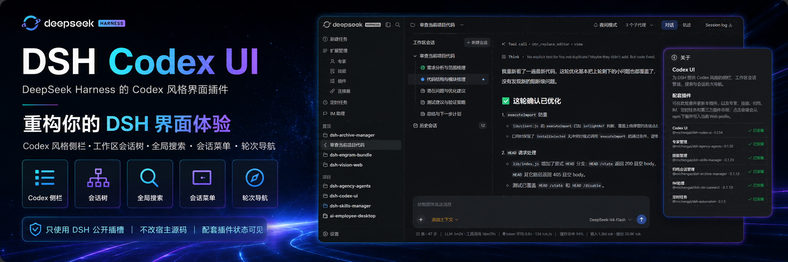
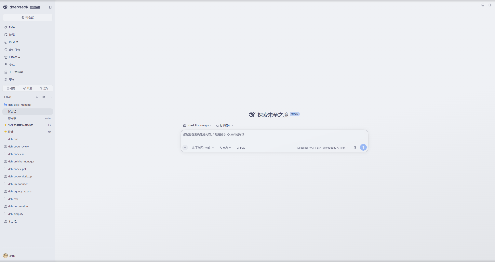
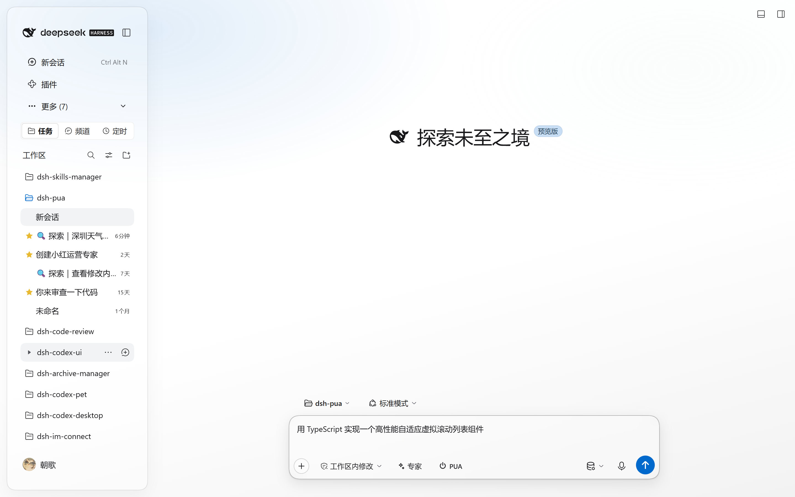
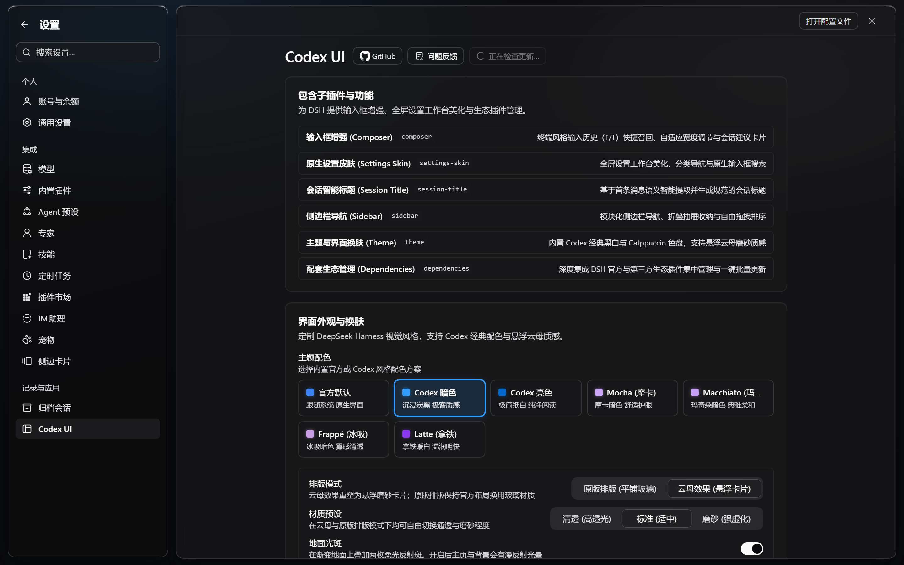
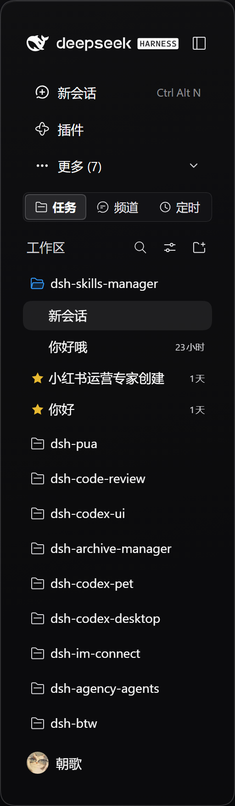
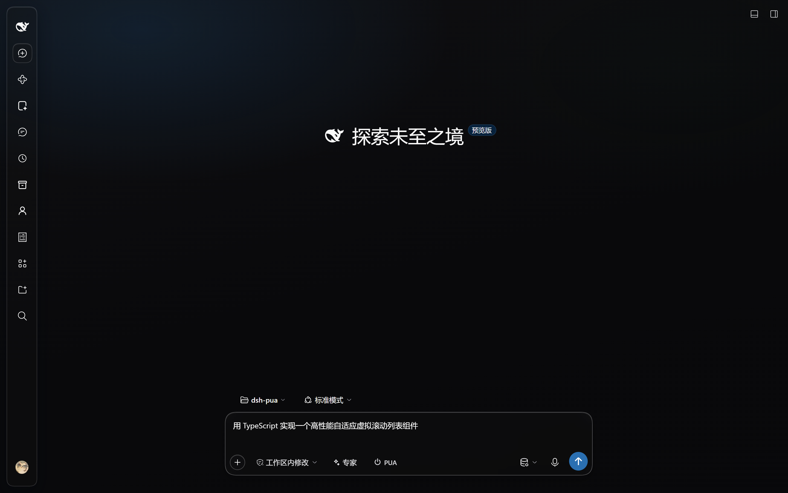
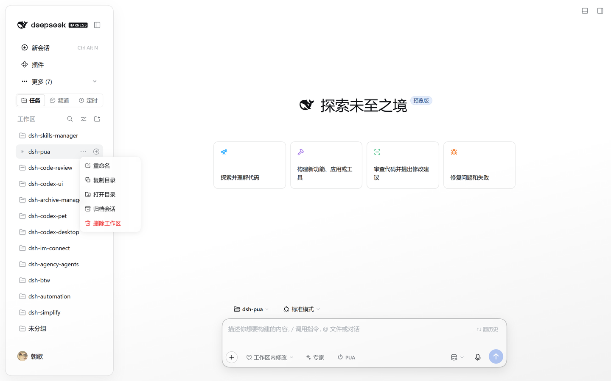

<p align="center">
  
</p>

<div align="center">

  # DSH Codex UI v2.0

  **Conjunto moderno de interface para o DeepSeek Harness: Histórico de comandos instantâneo, painel de configurações em tela cheia, temas com vidro fosco físico e barra lateral modular**

  [简体中文](README.zh-CN.md) · [English](README.en.md) · [日本語](README.ja.md) · [Español](README.es.md) · [Français](README.fr.md) · [Deutsch](README.de.md) · [Русский](README.ru.md) · [Português](README.pt.md)

  [Histórico de alterações](CHANGELOG.md) · [Apache-2.0](LICENSE)

  [](LICENSE)
  [](https://www.npmjs.com/package/@michengai/dsh-codex-ui)
  [](https://www.npmjs.com/package/@michengai/dsh-codex-ui)
  [](https://github.com/MichengAI/dsh-codex-ui)
  [](https://nodejs.org/)

</div>

> **Aviso**: O DSH Codex UI é um plugin de interface mantido pela comunidade para o DeepSeek Harness (DSH) e não é um produto oficial da DeepSeek AI.

---

## Por que escolher o Codex UI 2.0?

No uso diário do DeepSeek Harness, a interface padrão pode apresentar caixas de diálogo estreitas, temas monótonos ou perda do histórico de comandos. **O Codex UI 2.0 foi totalmente reestruturado em sua arquitetura e design visual**, reunindo **seis subplugins desacoplados e gerenciamento de ecossistema integrado**, de alto desempenho e foco na experiência nativa:

* 🚀 **Recuperação rápida e previsão inteligente**: Previsão de digitação em linha (`Tab` para aceitar, `Alt+Abaixo/Acima` para alternar opções), histórico de comandos estilo terminal (`↑` / `↓`) e alças de largura adaptáveis;
* 🪟 **Painel de configurações em tela cheia**: Substitui diálogos estreitos por uma tela ampla com iluminação difusa Ambient Ground e cartões flutuantes;
* 🎨 **Temas com vidro fosco físico e mica**: 14 paletas de alta qualidade (séries Codex, Claude, Dracula, Cyberpunk, Solarized, Gruvbox e Catppuccin), modos de layout plano e flutuante, 3 níveis de desfoque e brilhos de chão;
* 🧭 **Barra lateral modular**: Gaveta tipo sanfona fluida e reorganização livre por arrasto; quando recolhida, **alinha-se 100% ao trilho oficial nativo de 56px**;
* 🧠 **Títulos de sessão inteligentes**: Extração semântica da primeira mensagem para gerar títulos padronizados adaptados a modelos de raciocínio de contexto longo;
* 🌐 **Compatibilidade nativa com os 8 idiomas oficiais**: Suporte completo para português, inglês, chinês, japonês, espanhol, francês, alemão e russo (`pt`, `en`, `zh`, `ja`, `es`, `fr`, `de`, `ru`), adaptando textos, cartões iniciais, menus de contexto e títulos;
* 🖥️ **Menus de janela da área de trabalho**: Integração de menu de ajuda na barra de título do aplicativo com recarregamento de visualização e reinicialização segura do Host;
* 📦 **Gestão do ecossistema**: Painel unificado para plugins oficiais e de terceiros, verificação de versões e atualização em lote em um clique.

---

## Evolução Arquitetural: Por que uma reescrita completa?

### 1. O dilema da versão 1.x: Dívida técnica por sobreposições agressivas
Nos primeiros dias do ecossistema DSH, não existiam registros de Slots oficiais nem bibliotecas de primitivos headless. A versão 1.x precisava sequestrar nós do DOM e injetar estilos CSS globais.
Isso causava quebras repentinas a cada atualização do Host DSH, além de deixar resíduos CSS ao desativar temas.

### 2. Princípios de design da versão 2.0: Respeito integral aos padrões nativos
Na versão 2.0.0, todo o código antigo de sobreposição foi **descartado** em favor de uma base limpa em micro-kernel:
* 🏛️ **Uso rigoroso de componentes nativos**: Abolição de widgets CSS desenhados à mão, utilizando exclusivamente os componentes `Switch` e `Button` oficiais;
* 🧩 **6 subplugins modulares**: Fronteiras bem delimitadas garantem ciclos de vida independentes e manutenção previsível;
* 🛡️ **Segurança fail-closed**: Ao desativar um módulo, todos os estilos e cartões são removidos imediatamente do DOM sem deixar rastros;
* 🔒 **Isolamento estrito de perfis**: Resolução inequívoca de diretórios para evitar interferências entre perfis.

---

## Arquitetura: 6 Subplugins Principais e Módulo Integrado

| ID do Subplugin | Nome | Funcionalidades |
| :--- | :--- | :--- |
| `composer` | **Melhorias de Entrada (Composer)** | Previsão inteligente (`Tab`), histórico de terminal (`↑`/`↓`), isolamento por conversa ou espaço de trabalho, alças de largura e sugestões. |
| `settings-skin` | **Visual de Configurações (Settings Skin)** | Painel em tela cheia, cartões flutuantes de opções, fundo Ambient Ground e busca nativa. |
| `theme` | **Temas e Vidro Fosco (Theme)** | 14 paletas de cores, modos Plano vs. Cartões Mica, 3 pré-definições de desfoque e brilhos de reflexo. |
| `sidebar` | **Barra Lateral Modular (Sidebar)** | Seções de espaços de trabalho (incluindo atalho direto «Adicionar espaço de trabalho» nos cabeçalhos, exibido conforme a disponibilidade do seletor de pastas do host com posicionamento automático), expansão suave, reorganização por arrasto, marcador de lido/não lido e aderência estrita ao trilho de 56px. |
| `session-title` | **Títulos de Sessão (Session Title)** | Geração padronizada de títulos baseada na semântica da primeira solicitação, com suporte a 8 idiomas e até 4096 tokens. |
| `desktop-menu` | **Menus do Desktop (Desktop Menus)** | Menu de ajuda integrado na barra de título do aplicativo desktop, com recarregamento e reinício seguro do Host. |
| `dependencies` | **Gestão de Dependências (Integrado)** | Monitoramento de plugins integrados, contagem de downloads npm em tempo real e atualização em lote com um clique. |

---

## Capturas de Tela em Ambiente Real

> *Todas as imagens foram capturadas diretamente em instâncias em execução do DeepSeek Harness Web usando o `ego-browser`.*

### 1. Espaço de trabalho imersivo e área de entrada (Modo Escuro)
Paleta Codex Dark com ações centralizadas, cartões de sugestão e campo de entrada inferior com alças adaptáveis e dicas de histórico `↑↓`.



---

### 2. Espaço de trabalho branco papel (Modo Claro)
Paleta Codex Light com iluminação difusa Ambient Ground para uma leitura agradável e sem cansaço visual.



---

### 3. Painel de configurações em tela cheia (Sistema de Cartões Modulares)
Amplo ambiente de trabalho organizado em cartões temáticos de acordo com os componentes ativos.



---

### 4. Personalização de tema e textura de vidro
14 paletas de cores de alta qualidade integradas e 1 opção oficial padrão (abrangendo as séries Codex, Claude, Dracula, Cyberpunk, Solarized, Gruvbox e Catppuccin). Suporta modos de layout plano tradicional e flutuante Mica, 3 níveis de predefinição de material (Transparente, Padrão, Fosco) e interruptor de reflexo no chão. Construído com injeção dinâmica de Design Tokens e destruição de ciclo de vida limpa, eliminando a poluição de estilos globais.

#### Visão geral dos temas integrados e esquemas de cores

| Série | Nome do tema | ID | Modo | Estilo visual | Paleta principal (Destaque / Fundo / Texto) |
| :--- | :--- | :--- | :--- | :--- | :--- |
| **Oficial** | **Oficial padrão** | `stock` | Auto | Seguir o sistema Interface nativa | Accent:  `#3b82f6` (Segue o modo claro/escuro do sistema, sem tokens personalizados) |
| **Codex** | **Codex Escuro** | `codex-dark` | Escuro | Carvão imersivo Visual hacker | Accent:  `#339cff` · BG:  `#09090b` · Text:  `#fafafa` |
|  | **Codex Claro** | `codex-light` | Claro | Branco papelLeitura pura | Accent:  `#0169cc` · BG:  `#ffffff` · Text:  `#18181b` |
| **Claude** | **Claude Escuro** | `claude-dark` | Escuro | Tom escuro quente e terracota | Accent:  `#d97757` · BG:  `#141414` · Text:  `#fdfdfd` |
|  | **Claude Claro** | `claude-light` | Claro | Papel quente e terracota | Accent:  `#d97757` · BG:  `#faf9f5` · Text:  `#1f1e1d` |
| **Dracula** | **Dracula** | `dracula` | Escuro | Rosa vampiro e brilho ciber | Accent:  `#ff79c6` · BG:  `#191a21` · Text:  `#f8f8f2` |
| **Cyberpunk** | **Cyberpunk** | `cyberpunk` | Escuro | Verde neon no preto · terminal matrix | Accent:  `#00ff41` · BG:  `#000a00` · Text:  `#00ff41` |
| **Solarized** | **Solarized Escuro** | `solarized-dark` | Escuro | Azul petróleo e ciano | Accent:  `#2aa198` · BG:  `#002b36` · Text:  `#93a1a1` |
|  | **Solarized Claro** | `solarized-light` | Claro | Pergaminho quente e azul | Accent:  `#268bd2` · BG:  `#fdf6e3` · Text:  `#586e75` |
| **Gruvbox** | **Gruvbox Escuro** | `gruvbox-dark` | Escuro | Escuro retrô e ouro quente | Accent:  `#fabd2f` · BG:  `#282828` · Text:  `#fbf1c7` |
|  | **Gruvbox Claro** | `gruvbox-light` | Claro | Papel kraft retrô e âmbar | Accent:  `#b57614` · BG:  `#fbf1c7` · Text:  `#282828` |
| **Catppuccin** | **Mocha** | `catppuccin-mocha` | Escuro | Mocha escuro Confortável para os olhos | Accent:  `#cba6f7` · BG:  `#11111b` · Text:  `#cdd6f4` |
|  | **Macchiato** | `catppuccin-macchiato` | Escuro | Macchiato escuro Suave e elegante | Accent:  `#c6a0f6` · BG:  `#181926` · Text:  `#cad3f5` |
|  | **Frappé** | `catppuccin-frappe` | Escuro | Frappé escuro Névoa translúcida | Accent:  `#ca9ee6` · BG:  `#232634` · Text:  `#c6d0f5` |
|  | **Latte** | `catppuccin-latte` | Claro | Latte quente Acolhedor e suave | Accent:  `#8839ef` · BG:  `#eff1f5` · Text:  `#4c4f69` |

---

### 5. Navegação modular na barra lateral (Expandida)
Itens reorganizáveis, gaveta tipo sanfona para ferramentas e atalhos de acesso rápido fixados.



---

### 6. Trilho nativo oficial de 56px (Recolhido)
Recolhe-se com total fluidez no trilho compacto de 56px oficial, mantendo os ícones alinhados e o botão de Novo Chat em evidência.



---

### 7. Menu de contexto avançado de sessões
Ações imediatas na lista de conversas: Fixar, Renomear, Marcar como não lido/lido, Arquivar, Bifurcar e Exclusão segura.



---

## Compatibilidade com o Host

* **Gerações Suportadas**: Linha completa DeepSeek Harness `0.2.x` (`>=0.2.0-rc.1 <0.3.0-0`);
* **Compilações Verificadas**: Todas as versões Release Candidate `0.2.x` (`0.2.0-rc.1`, `0.2.0-rc.2`, `0.2.1-rc.1`–`0.2.1-rc.5`, `0.2.2-rc.1`);
* **Requisitos de Execução**: Node.js `^22.19.0 || >=24.0.0`, pnpm `^11.0.0`.

> ⚠️ **Aviso**: Não habilite o Codex UI e o `ds-bot` simultaneamente, pois ambos alteram os slots da barra lateral com potenciais conflitos.

---

## Instalação e Primeiros Passos

### Opção A: Instalação Assistida por Agente (Recomendado)

Envie a instrução abaixo para qualquer agente com permissão de terminal (substitua `web` pelo perfil de destino):

```text
Instale o plugin DSH @michengai/dsh-codex-ui no meu perfil web local executando:
dsh plugin --profile web add @michengai/dsh-codex-ui@latest --registry=https://registry.npmjs.org/
Em seguida, execute dsh --profile web --dump-config para verificar a ativação e recarregue a página no navegador.
```

### Opção B: Instalação Manual

Execute no PowerShell ou MSYS Bash:

```powershell
[Console]::OutputEncoding = [System.Text.Encoding]::UTF8
$OutputEncoding = [System.Text.Encoding]::UTF8
dsh plugin --profile web add @michengai/dsh-codex-ui@latest --registry=https://registry.npmjs.org/
dsh --profile web --dump-config
```

Após a instalação, reinicie a instância do DSH Web e force a atualização da página no navegador (`Ctrl + Shift + R` ou `Cmd + Shift + R`).

---

## Guia Rápido de Utilização

| Funcionalidade | Como Usar |
| :--- | :--- |
| **Aceitar previsão de digitação** | Pressione `Tab` quando o texto sugerido aparecer após o cursor; use `Alt + Abaixo` / `Alt + Acima` para alternar ou `Esc` para dispensar. |
| **Configurar modo de previsão** | Vá em **Configurações → Codex UI** e selecione o modo (Desativado / Somente continuação / Sugestão+continuação) no cartão «Melhorias de Entrada». Pode ser desativado no perfil via `config.prediction: false` em `cordis.patch.yml`. |
| **Histórico de comandos** | Em um campo de entrada vazio, pressione `↑` / `↓` para navegar pelas entradas anteriores desta conversa — ou de todo o espaço de trabalho, alternável nas Configurações (até 200 itens por escopo). |
| **Alterar escopo do histórico** | No mesmo cartão «Aprimoramentos de entrada», escolha «Escopo do histórico»: «Esta conversa» (padrão) recupera apenas entradas da conversa atual; «Espaço de trabalho» compartilha com todas as conversas do mesmo diretório de trabalho e torna novamente visível o histórico de espaço de trabalho salvo anteriormente (mantido até o limite de 100 escopos recentes antes de ser descartado). |
| **Redimensionar largura** | Posicione o cursor sobre as bordas laterais da caixa de entrada e arraste as alças azuis. |
| **Alternar temas e desfoque** | Em **Configurações → Codex UI**, selecione uma das 14 paletas e alterne entre os modos de vidro Plano e Mica Flutuante. |
| **Reordenar barra lateral** | Arraste verticalmente os itens; os guias azuis indicam o ponto exato para mover para dentro ou fora do menu «Mais». |
| **Adicionar espaço de trabalho pela seção** | Passe o mouse ou foque no título de qualquer seção (Fixados, Projetos ou personalizada) e clique no ícone «Adicionar espaço de trabalho» ao lado de `···` (exibido quando o seletor de diretórios do host está disponível); o novo espaço é inserido e expandido nela automaticamente. |
| **Recolher barra lateral** | Clique no botão no topo da barra para alternar para o trilho oficial compacto de 56px. |
| **Atualizar plugins em lote** | Em **Configurações → Codex UI**, clique em **Instalar/atualizar tudo** no cartão de extensões complementares. |

---

## Matriz do Ecossistema

Combine o Codex UI com as extensões complementares oficiais para um ambiente integrado:

| Plugin | Finalidade |
| :--- | :--- |
| [Codex UI](https://github.com/MichengAI/dsh-codex-ui) | **Núcleo de UI**: Histórico rápido, visual de configurações, vidro fosco e barra modular |
| [Agency Agents](https://github.com/MichengAI/dsh-agency-agents) | **Matriz de Especialistas**: Despacho de agentes especializados para diferentes tarefas |
| [Skills Manager](https://github.com/MichengAI/dsh-skills-manager) | **Central de Habilidades**: Descoberta, importação e ativação de habilidades locais |
| [Archive Manager](https://github.com/MichengAI/dsh-archive-manager) | **Gestão de Arquivos**: Busca profunda, restauração e limpeza de conversas anteriores |
| [IM Connect](https://github.com/MichengAI/dsh-im-connect) | **Ponte IM**: Conexão com WeChat, DingTalk, Feishu e QQBot |
| [Automation](https://github.com/MichengAI/dsh-automation) | **Automação**: Agendamentos com cron e auditoria de registros de execução |
| [Code Review](https://github.com/MichengAI/dsh-code-review) | **Revisão de Código**: Comando `/review` para auditoria de código autônoma com subagentes |
| [Simplify](https://github.com/MichengAI/dsh-simplify) | **Refatoração**: Comando `/simplify` para limpeza concorrente com 4 agentes |
| [PUA](https://github.com/MichengAI/dsh-pua) | **Resiliência**: Recuperação de falhas, teste de hipóteses e verificação de evidências |
| [BTW](https://github.com/MichengAI/dsh-btw) | **Perguntas Rápidas**: Consultas contextuais efêmeras sem interromper o fluxo principal |
| [Codex Pet](https://github.com/MichengAI/dsh-codex-pet) | **Mascote de Mesa**: Companheiro interativo para notificações e aprovações |

---

## Licença

Distribuído e licenciado sob a [Licença Apache 2.0](LICENSE).
