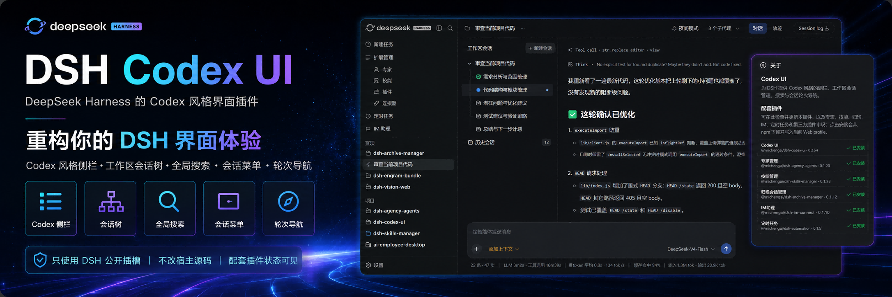
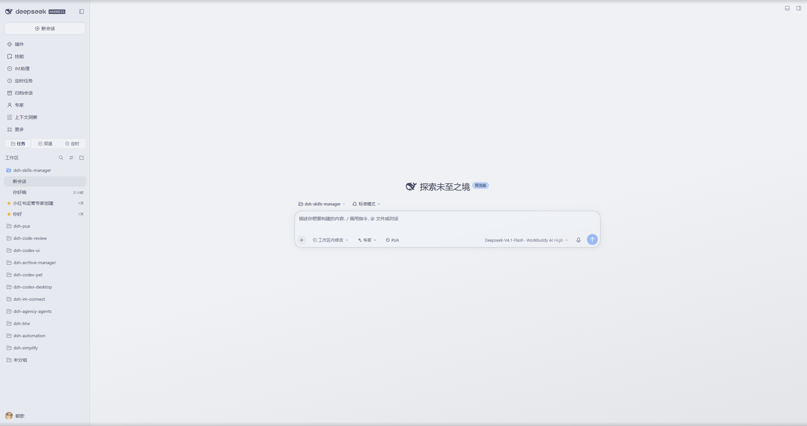
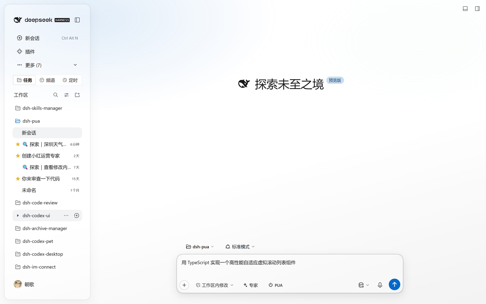
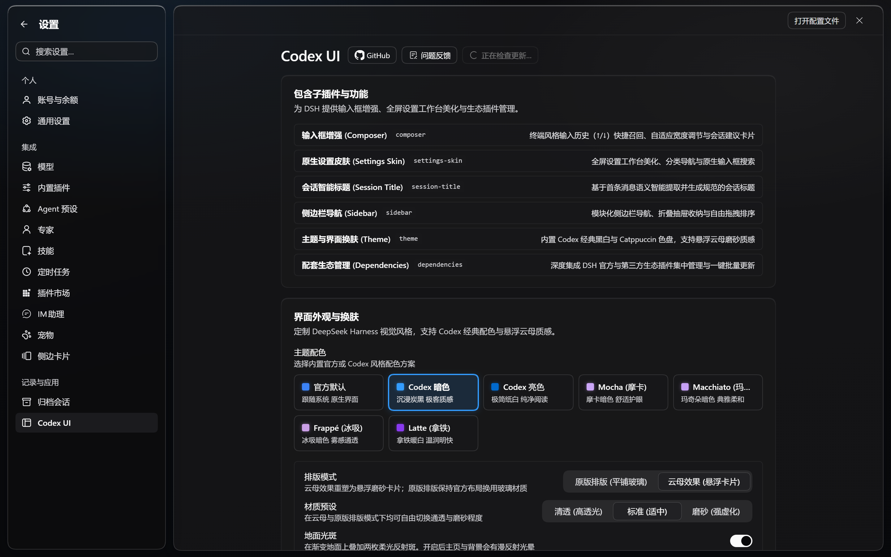
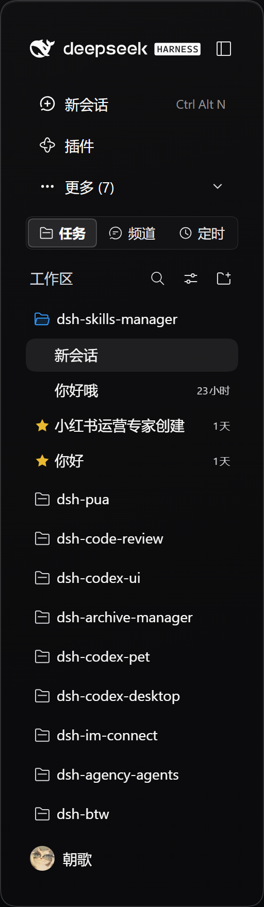
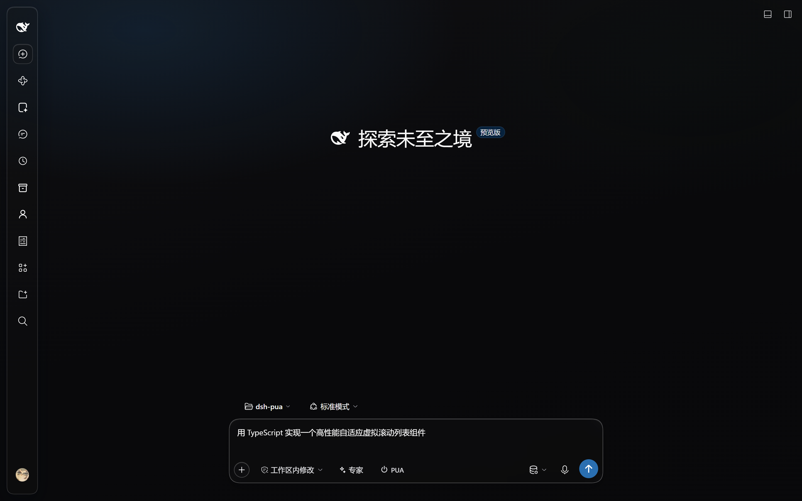
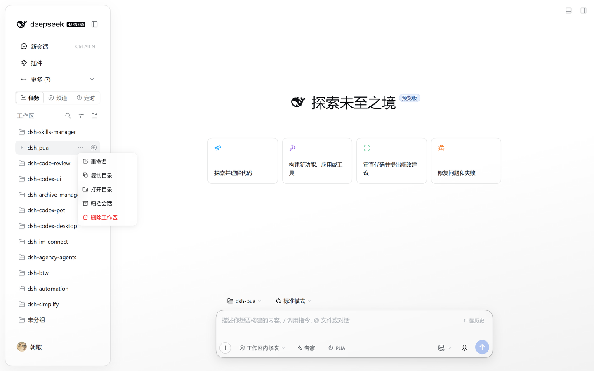

<p align="center">
  
</p>

<div align="center">

  # DSH Codex UI v2.0

  **现代化 DeepSeek Harness 全方位界面增强套件：极速历史召回、全屏设置皮肤、原生物理毛玻璃换肤与模块化侧栏**

  [English](README.md) · [更新日志](CHANGELOG.zh-CN.md) · [Apache-2.0](LICENSE)

  [](LICENSE)
  [](https://www.npmjs.com/package/@michengai/dsh-codex-ui)
  [](https://www.npmjs.com/package/@michengai/dsh-codex-ui)
  [](https://github.com/MichengAI/dsh-codex-ui)
  [](https://nodejs.org/)

</div>

> **声明**：DSH Codex UI 是社区维护的 DeepSeek Harness（DSH）现代化界面增强插件，并非 DeepSeek AI 官方产品。

---

## 为什么选择 Codex UI 2.0？

在日常使用 DeepSeek Harness 时，原生界面可能存在设置窗口狭小局促、主题配色单一、侧栏长插件列表不易整理、输入历史丢失等痛点。**Codex UI 2.0 经历了从底层架构到视觉体系的全面重塑**，以**六大独立子插件**构建起一套高性能、低侵入、官方原生的现代化界面增强体系：

* 🚀 **极速输入召回**：终端风格输入框历史（`↑` / `↓` 快捷召回），支持自适应宽度微调；
* 🪟 **全屏悬浮双岛设置**：告别局促模态框，接入 Ambient Ground 漫反射画布与双岛卡片工作台；
* 🎨 **物理级毛玻璃换肤**：内置 7 款高品质主题配色（含 Codex 炭黑与极简纸白），支持原版平铺玻璃与云母悬浮双排版模态、三档材质预设与独立地面光斑；
* 🧭 **模块化侧边栏**：展开态支持原位平滑折叠抽屉与自由拖拽排序；收缩折叠态 **100% 对齐宿主官方 56px 原生导轨**，所有图标整齐排列、新会话常驻高对比度；
* 🧠 **智能会话标题**：首条消息语义解析，自动提炼精炼标题，完美适配推理大模型长上下文；
* 📦 **生态配套管理**：官方与第三方生态插件集中看护、版本检测与一键批量升级。

---

## 为什么选择彻底重构？（历史演变与技术决策）

### 1. 早期 1.x 时代的无奈选择：“暴力覆盖组件”的技术负债
在 DeepSeek Harness（DSH）生态起步阶段，官方宿主的客户端扩展能力与基础设施尚不完善：不仅缺少细粒度的标准 Slots 插槽机制，亦未开放官方原语控件库，插件生命周期钩子也相对稀少。为了能在短时间内为开发者打造出接近 OpenAI / Codex 质感的沉浸式体验，**早期 1.x 版本不得不采用了大量激进的“覆盖组件”策略**：直接拦截并强行替换宿主 DOM 树、使用高权重 CSS 暴力覆盖原生视图、全量硬编码注入自定义 CSS 变量。

**随之而来的维护困局**：随着 DSH 官方宿主的快速迭代演进（先后引入 `profile` 多环境隔离体系、`shortcuts` 服务门控、标准 Slots 插槽注册契约以及官方原生原语库 `@deepseek-ai/dsh-client-ui-primitives` 等），早期“强行覆盖”的技术负债开始集中爆发，日常维护愈发举步维艰：
* 💥 **版本兼容极度脆弱**：宿主上游稍有 DOM 结构微调或 CSS 类名 hash 变动，就会导致覆盖式选择器失效甚至整页渲染崩溃，难以平滑跟进官方新特性；
* 🎨 **样式污染与半降级顽疾**：暴力注入的全局样式难以做到干净的生命周期销毁。当用户切换或关闭自定义主题时，残存的根属性与色彩变量导致原生暗色模式被严重污染，甚至出现“毛玻璃材质关闭了、但深色背景被卡死无法复原”的半降级尴尬；
* 🧩 **状态脱节与“僵尸配置”**：在插件或子特性被停用时，覆盖式组件无法干净退回到宿主原生外观，依然在设置面板中渲染无法生效的失效配置项，破坏了系统的整洁度与用户心智。

### 2. 2.0.0 的彻底重构决策：全面拥抱官方原生体系
面对维护困局，我们在 2.0.0 版本痛定思痛，**彻底推翻了 1.x 的全部“组件覆盖”代码**，确立了**“零侵入、微内核解耦、全面拥抱官方原生”**的全新技术路线：
* 🏛️ **严格复用官方原生原语与标准 Slots**：坚决禁止用 CSS 自行手绘宿主已有控件，全面接入官方 `Switch`、`SegmentedControl`、`Button` 原生原语库；侧栏收起时 100% 严丝合缝退回官方原生 56px 导轨规范，真正做到与宿主体系同生共荣；
* 🧩 **六大微内核子插件物理解耦**：将臃肿的单体代码彻底拆解为 6 个高内聚、自闭环的独立子插件，彼此边界分明、支持按需独立启停，极大提升了工程可维护性与审计透明度；
* 🛡️ **严格的 Fail-Closed 熔断与动态隐匿 UI**：建立标准的高可用防御契约。一旦探测到子插件在当前 Profile 被停用或服务端不可达，底层不仅物理熔断 Token 注入并彻底清空根属性，前台设置面板更会**直接整体隐匿对应卡片（0 DOM 节点）**，绝不残留任何置灰死项，瞬间 100% 干净回退至官方原生；
* 🔒 **严格 Profile 隔离与无缝自愈机制**：统一权威的 Profile 路径解析，彻底杜绝跨环境串读与配置污染；同时接入 `focus` 窗口重获焦点自愈探活，兼顾极致安全与网络抖动下的高可用性；
* 🎨 **纯正 Codex 科技蓝黑美学**：彻底清洗历史残留的绿色硬编码，精准还原官方 `#339cff` 科技蓝、极简纸白与沉浸炭黑质感，辅以双排版模态与地面柔光反射光斑。

---

## 六大核心子插件架构

| 子插件 ID | 模块名称 | 核心能力说明 |
| :--- | :--- | :--- |
| `composer` | **输入框增强** | 终端风格历史记录（`↑`/`↓`）快捷召回、工作区隔离存储、自适应宽度拖拽手柄与快捷提示。 |
| `settings-skin` | **原生设置皮肤** | 全屏设置工作台美化、悬浮双岛架构、Ambient Ground 自然光漫反射底板、分类导航与原生输入框搜索。 |
| `theme` | **主题与界面换肤** | 内置 7 款主题配色（含 Appearance Cube 色彩方块）、原版平铺/云母悬浮双排版、三档材质预设与地面光斑开关。 |
| `sidebar` | **模块化侧栏导航** | 模块化侧边栏导航、手风琴原位平滑折叠抽屉、自由拖拽排序；折叠态 100% 对齐宿主官方 56px 原生导轨。 |
| `session-title` | **会话智能标题** | 基于首条消息语义提取并生成规范的会话标题，支持推理模型 4096 tokens 上下文，防止乱码截断。 |
| `dependencies` | **配套生态管理** | 深度集成 DSH 官方与第三方生态插件集中管理，实时显示 npm 下载量、安装状态与一键批量升级。 |

---

## 真机界面预览

> *以下界面均使用 `ego-browser` 在真实的 DeepSeek Harness Web 运行环境中捕获。*

### 1. 沉浸主界面与输入增强（深色模式）
沉浸炭黑（Codex Dark）配色，居中展示品牌标语与快捷动作引导卡片，底部输入框提供「↑↓ 翻历史」快捷召回与自适应宽度手柄。



---

### 2. 极简纸白主界面（浅色模式）
极简纸白（Codex Light）配色，接入 Ambient Ground 自然光漫反射渐变底板，温润通透，视觉流平滑舒缓。



---

### 3. 全屏悬浮双岛设置中心（模块化卡片体系）
告别局促的弹窗，重塑为模块化卡片工作台（功能与内置子插件、界面外观与换肤、配套管理插件），层次严谨秩序井然，支持根据子组件启用状态动态自适应呈现。



---

### 4. 界面外观换肤与毛玻璃配置
内置 7 款主题色盘（官方默认、Codex 经典科技蓝黑白、Mocha、Macchiato、Frappé、Latte），支持原版平铺玻璃与云母悬浮双模态，清透/标准/磨砂三档材质直选与地面反射光斑开关。

---

### 5. 模块化侧边栏导航（展开态）
支持插件、技能、常用工具（IM 助理、定时任务、归档会话、代码审查等）自由拖拽排序与「更多」手风琴平滑折叠收纳。



---

### 6. 官方原生 56px 折叠导轨（收缩态）
侧栏收起后自动对齐官方原生紧凑 56px 导轨规范，无缝完整显示全部功能图标，新会话常驻高亮显示，无需鼠标悬停试探。



---

### 7. 增强会话菜单
支持在会话项上快速执行置顶、重命名、未读标记、归档、派生新会话与安全清理。



---

## 宿主兼容性

* **支持范围**：DeepSeek Harness `0.2.x` 全系列（`>=0.2.0-rc.1 <0.3.0-0`）；
* **实测验证**：已在 `0.2.0-rc.1`、`0.2.0-rc.2`、`0.2.1-rc.1`、`0.2.1-rc.2`、`0.2.1-rc.3`、`0.2.1-rc.4`、`0.2.2-alpha.2` 深度验证通过，并向后自动兼容后续 RC 与日常构建；
* **环境要求**：Node.js `^22.19.0 || >=24.0.0`，pnpm `^11.0.0`。

> ⚠️ **互斥提示**：请勿同时启用 Codex UI 与 `ds-bot`。两者均重塑侧栏与主会话插槽，功能重叠。启用前请先停用或卸载另一个。

---

## 安装与快速上手

### 方式 A：让 Agent 帮您安装（推荐）

复制以下指令发送给任意具备终端执行权限的 Agent（将 `web` 替换为您实际使用的 profile 名称）：

```text
请将 DSH 插件 @michengai/dsh-codex-ui 安装到本机 web profile，执行：
dsh plugin --profile web add @michengai/dsh-codex-ui@latest --registry=https://registry.npmjs.org/
安装后执行 dsh --profile web --dump-config 确认包含 codex-ui，并提示我刷新浏览器。
```

### 方式 B：终端手动安装

在终端（Windows PowerShell 或 MSYS Bash）中执行：

```powershell
[Console]::OutputEncoding = [System.Text.Encoding]::UTF8
$OutputEncoding = [System.Text.Encoding]::UTF8
dsh plugin --profile web add @michengai/dsh-codex-ui@latest --registry=https://registry.npmjs.org/
dsh --profile web --dump-config
```

安装完成后，重启 DSH Web 实例并硬刷新浏览器页面（`Ctrl + Shift + R` 或 `Cmd + Shift + R`）即可进入全新 2.0 体验！

---

## 常用操作速查

| 场景 | 操作方式 |
| :--- | :--- |
| **找回历史输入** | 输入框为空时按键盘 `↑` / `↓` 方向键，即时召回在当前工作区提交过的历史文本（按工作区隔离存储 200 条）。 |
| **调节输入框宽度** | 悬停至输入框左右边缘，拖拽蓝色手柄即可自定义最舒适的编写宽度。 |
| **切换主题与质感** | 打开「设置 → Codex UI」，在「界面外观与换肤」卡片单选 7 款主题，直选原版/云母模式与材质预设。 |
| **调整侧栏图标顺序** | 鼠标按住展开侧栏中的任意插件条目拖拽上下移动，蓝线指示放置位置，支持拖入/拖出「更多」手风琴。 |
| **折叠/收起侧边栏** | 点击侧栏顶部折叠按钮；收缩后自动切换为 56px 原生导轨，单手盲点所有功能图标。 |
| **生态插件批量更新** | 在「设置 → Codex UI」底部「配套管理插件」卡片，点击「全部更新」自动安装最新配套依赖。 |

---

## DSH 现代化生态矩阵

如需搭配完整的开发运维闭环，可按需在配套管理卡片中一键启用以下生态插件：

| 插件名称 | 核心用途 |
| :--- | :--- |
| [Codex UI](https://github.com/MichengAI/dsh-codex-ui) | **界面总控**：极速输入召回、全屏设置皮肤、毛玻璃换肤与模块化侧栏 |
| [Agency Agents](https://github.com/MichengAI/dsh-agency-agents) | **专家调度**：任务精准画像，一键召唤行业专家角色矩阵 |
| [Skills Manager](https://github.com/MichengAI/dsh-skills-manager) | **技能枢纽**：本地技能统一发现、导入、启停与智能配置 |
| [Archive Manager](https://github.com/MichengAI/dsh-archive-manager) | **归档管理**：历史会话深度检索、恢复与安全物理归档清理 |
| [IM Connect](https://github.com/MichengAI/dsh-im-connect) | **消息串联**：连接微信、钉钉、飞书、QQBot 双向派发与接收任务 |
| [Automation](https://github.com/MichengAI/dsh-automation) | **定时管家**：Cron 定时流水线看护与运行证据追踪 |
| [Code Review](https://github.com/MichengAI/dsh-code-review) | **代码审查**：`/review` 独立审查子代理并直接向当前会话投递严谨评审报告 |
| [Simplify](https://github.com/MichengAI/dsh-simplify) | **代码精简**：`/simplify` 4-agent 并发精简与坏味道消除 |
| [PUA](https://github.com/MichengAI/dsh-pua) | **韧性强化**：失败自动归因重试，完工证据多维校验守门员 |
| [BTW](https://github.com/MichengAI/dsh-btw) | **临时旁问**：长任务进行中轻量旁问，不破坏主线程上下文 |
| [Codex Pet](https://github.com/MichengAI/dsh-codex-pet) | **桌面宠物**：任务状态动态浮窗交互、工具审批与拟人化提醒 |

---

## 许可证

本项目基于 [Apache License 2.0](LICENSE) 开源协议分发与维护。
